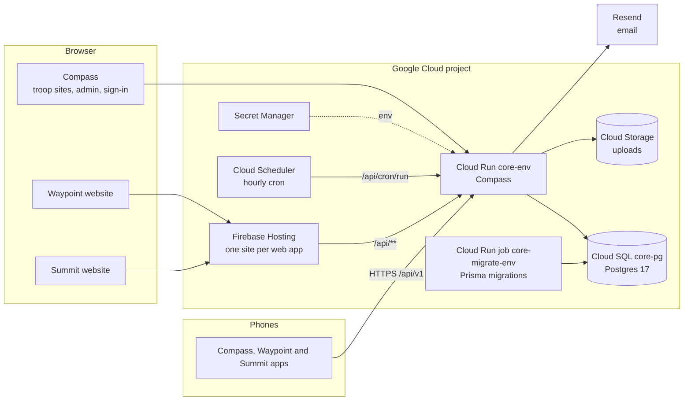

# Deploying on Google Cloud

Compass is the family's core service: the troop site and the API that Waypoint (merit badges and events, `jonshern/bluecard`) and Summit (the scout's trail, `jonshern/emmett-scouting`) call. This is its Google Cloud setup, described in Terraform (`infra/`) and deployed by GitHub Actions. It replaces fly.io once the move is decided; until then both exist side by side and nothing here runs.

**Nothing in this setup does anything until the `GCP_PROJECT_ID` repository variable is set.** The *Deploy*, *Preview* and *Infra* workflows skip themselves without it, and the fly.io deployment (`fly.toml`, the Dockerfile's migrate-on-boot `CMD`) is untouched.

## The shape of it



| Piece | Service | Notes |
|---|---|---|
| Core service | Cloud Run `core-<env>` (Node 22, port 3000, 1 GiB) | This repository's Dockerfile. Cloud Run starts it with `npm run start`; it never migrates on boot here. Scales to zero. |
| Database | Cloud SQL Postgres 17 `core-pg` (`db-f1-micro`) | One instance for the family; `compass_staging` and `compass_prod` databases on it. Daily backups, 7-day point-in-time restore, deletion protection. |
| Migrations | Cloud Run job `core-migrate-<env>` (`scripts/migrate.sh`) | Runs with the schema owner's login before traffic moves, then grants the server's login row access only. A failed migration stops the deploy. |
| Web apps | Firebase Hosting, sites `<prefix>-waypoint`, `<prefix>-summit` and `<prefix>-landing` (`-staging` for staging) | Created here; Waypoint's and Summit's repositories build and publish to them, and rewrite `/api/**` to `core-<env>` in their own `firebase.json`. `landing` is the family's one static page (bluecard `marketing/landing/`), served on the apex domain with `www` redirecting to it. |
| Uploads | Cloud Storage (`STORAGE_DRIVER=gcs`) | Private bucket. Photo bytes are encrypted per organization before they are stored. |
| Secrets | Secret Manager | `MASTER_KEY`, `BETTER_AUTH_SECRET`, the token secrets and database URLs are generated by Terraform. The Resend key and Google sign-in client are added by hand. |
| Background jobs | Cloud Scheduler | `POST /api/cron/run` hourly with the `X-Tasks-Token` header, which runs `runCronTick` (newsletters, rules, retention). |
| CI/CD auth | Workload Identity Federation | No stored keys. This repository deploys everything; Waypoint's and Summit's repositories get a separate account that can only publish to Firebase Hosting. |

## Environments

| Environment | Core service | Data | Deploys when |
|---|---|---|---|
| Preview | tagged revision `pr-<n>` of `core-staging`, no traffic | staging | every push to a PR; link posted on the PR |
| Staging | `core-staging` | `compass_staging` | every merge to `main` |
| Production | `core-prod`, or a custom domain | `compass_prod` | after staging passes; add a required reviewer on the `production` environment for a one-click promote |

Staging and previews skip the pre-launch invite gate and let admins in without two-step sign-in; production requires both. Previews never migrate staging; the PR's migrations run on staging when it merges.

## What's in the repo

| Path | What it is |
|---|---|
| `infra/bootstrap/` | One-time Terraform from a laptop: state bucket, keyless GitHub auth for this repository and the web apps' repositories, budget alert |
| `infra/` | Everything else, applied by the *Infra* workflow: database, service, migrate job, hosting sites, bucket, secrets, scheduler, monitoring |
| `infra/modules/environment/` | The per-environment pieces, stamped out for `staging` and `prod` |
| `scripts/migrate.sh` | The migrate job: `prisma migrate deploy`, then row-only grants for the server's login |
| `scripts/deploy-api.sh` | Migrate, roll out, smoke test `/health`, roll back on failure |
| `scripts/set-github-vars.sh` | Copies Terraform outputs into GitHub variables on all three repositories |
| `src/app/api/cron/run/` | The endpoint Cloud Scheduler calls |
| `.github/workflows/deploy.yml`, `preview.yml`, `infra.yml` | The GCP workflows |
| [`runbooks-gcp.md`](runbooks-gcp.md) | Rollback, restore, every alert, incident response, secret rotation |

## Before the first apply

Three decisions are open and block any of this from running:

1. **One GCP project for the family?** The setup assumes yes.
2. **The domain.** Compass is `scoutingcompass.com` on fly.io today; Waypoint and Summit would be subdomains or their own names (`app_domains`, `custom_domains`), and the landing page takes the apex (`custom_domains = { prod = { landing = "example.org" } }`, plus `www` added as a redirect in the Firebase console).
3. **When to move off fly.io.** The move must **import the existing `MASTER_KEY`** from fly.io rather than let Terraform generate a new one, or every organization's encrypted roster and photos become unreadable without their recovery codes. Import it before the first apply that creates `core-prod`:
   ```sh
   # after bootstrap, before the first apply of infra/
   terraform -chdir=infra import 'module.environment["prod"].random_id.master_key' "$(printf '%s' "$FLY_MASTER_KEY" | xxd -r -p | base64 | tr '+/' '-_' | tr -d '=')"
   ```
   Then dump the fly.io Postgres and restore it into `compass_prod` before switching DNS.

## One-time setup

You need `gcloud`, `terraform` (1.9 or newer) and `gh`.

1. **Project and billing.**
   ```sh
   gcloud projects create <project-id>
   gcloud billing projects link <project-id> --billing-account=XXXXXX-XXXXXX-XXXXXX
   gcloud auth application-default login
   ```
2. **Bootstrap.**
   ```sh
   cd infra/bootstrap
   cp terraform.tfvars.example terraform.tfvars   # project and billing account
   terraform init && terraform apply
   cd ../.. && scripts/set-github-vars.sh
   ```
3. **Main stack.** Run the *Infra* workflow, or locally:
   ```sh
   cd infra
   cp terraform.tfvars.example terraform.tfvars   # alert_email at least
   terraform init -backend-config="bucket=<project-id>-tfstate" && terraform apply
   cd .. && scripts/set-github-vars.sh
   gh variable set ALERT_EMAIL --body you@example.org
   ```
   If Terraform says the Firebase terms have not been accepted, add the project once at console.firebase.google.com and apply again.
4. **Google sign-in.** Create an OAuth client with the redirect URI `https://<core host>/api/auth/google/callback`, then add `core-<env>-google-client-id` and `core-<env>-google-client-secret` with `gcloud secrets versions add`. Admins must use Google (or Apple) in production.
5. **Email.** Verify the sending domain in Resend, add `core-prod-resend-api-key`, then set `mail_drivers = { prod = "resend" }` and apply. Until then mail is logged, not sent.
6. **GitHub.** Create the `staging` and `production` environments in this repository; add yourself as a required reviewer on `production`.
7. **Ship.** Merge to `main`.
8. **First operator.** Register on production, then in Cloud SQL Studio (as `compass_prod`): `update "User" set "isSuperAdmin" = true where email = 'you@example.org';`.

## Day-to-day

| I want to... | Do this |
|---|---|
| Ship a change | Merge the PR. Staging, then prod. |
| Roll back | Re-run *Deploy* on an older commit, or send 100% traffic to the previous revision in Cloud Run. |
| Change infrastructure | Edit `infra/`, open a PR (plan in the *Infra* job summary), merge to apply. |
| Keep prod warm for an event | `prod = { min_instances = 1, ... }` in `environments`, apply, set back after. |
| Monitor a web app | Add it to `monitored_web_apps` after its first publish. |
| See logs | `gcloud run services logs read core-prod` |

## Monthly cost

About $12 to $17 for the whole family at troop scale: Cloud SQL `db-f1-micro` with backups ($9.50 to $11), Cloud Run within the free tier ($0 to $2), monitoring ($1 to $2), the rest under $1. Keeping prod warm adds $12 to $15 while on. The bootstrap sets a $25 budget alert.
